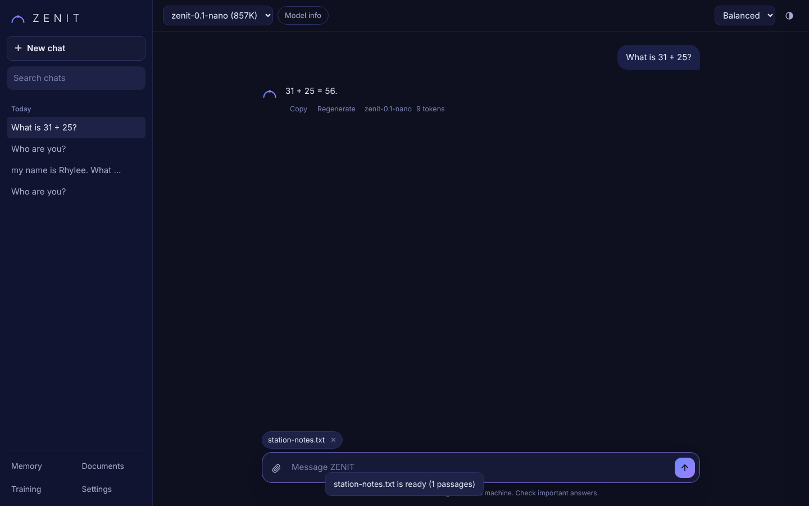
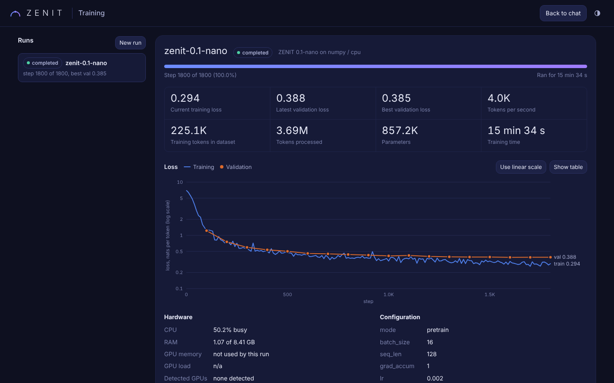

# ZENIT

ZENIT is your own language model platform. It has its own transformer architecture, tokeniser, training pipeline, trained weights, inference engine, API, memory, document search and web app. No generation request goes to another company's AI.





## Status: what exists today

**The default model is now Qwen3-4B-Instruct-2507, running locally in 4-bit** (`zenit-qwen3-4b` in `configs/serve.json`, weights in `models/qwen3-4b-instruct-2507`). It is an open-weight foundation model released by the Qwen team under Apache-2.0. ZENIT did not train or fine-tune it: ZENIT serves it, gives it the ZENIT system prompt, memory, documents and tools, and says so when asked what it is built on. It needs a CUDA GPU (the 4-bit weights take roughly 3 GB of VRAM, plus room for the context) and `pip install -e ".[local]"`.

**ZENIT 0.1-nano is trained and running.** It is a native ZENIT transformer, trained from scratch in this build. It is still served as `zenit-0.1-nano`.

| Fact | Value |
|---|---|
| Parameters | 857,216 |
| Training | 1,800 steps, 3.69M tokens processed, 15 min 34 s on a 2-core CPU, NumPy backend |
| Data | 225,112 training tokens of original CC0 seed data |
| Best validation loss | 0.385 nats per token |
| Generation speed | 533 tokens per second, 4.1 ms to first token (median, same CPU) |

Evaluation on the fixed suite (`evals/results/`, suite hash `2ca9aa688373`):

| Category | Score |
|---|---|
| General knowledge | 16.7% (2 of 12, both lucky: one repeats a memorised photosynthesis sentence, one finds 32 inside unrelated code) |
| Math | 46.7% (5 of 6 unseen two-digit additions correct, multiplication 0 of 3) |
| Coding | 0% |
| Reasoning | 0% |
| Instruction following | 0% |
| Conversation | 0% |
| Hallucination rate | 75% |

This model proves the whole stack works end to end. It is not a useful assistant, and the scores say so. ZENIT 1.0 to 5.5 need your GPU (see `docs/STRATEGY.md`).

**Built and tested:**

* Transformer in NumPy (with hand-written backpropagation, checked against finite differences) and PyTorch (same weights, parity tests)
* Byte-level BPE tokeniser with chat tokens, lossless on any input
* Data pipeline with license manifests, cleaning, PII scrubbing, exact and near-duplicate removal
* CPU and GPU trainers with checkpoints, best-model export, resume, stop button, resource estimates and a model registry
* LoRA and QLoRA SFT, DPO and merge scripts for open-weight foundation models
* Inference engines with KV cache, streaming and cancellation
* Persistent memory under user control, document upload and retrieval with citations
* API with keys, rate limits, usage stats and OpenAI-compatible chat
* Chat web app and training dashboard
* Evaluation suite with seven categories plus speed, and a contamination check

**Written but not run here:** the PyTorch trainer and the fine-tuning scripts. This build machine has no GPU and no PyTorch. Their tests run on your PC.

## Quick start (Windows, PowerShell)

```powershell
cd C:\Users\rhyle\source\repos\zenit
py -3.12 -m venv .venv
.venv\Scripts\Activate.ps1
pip install -e ".[dev]"
python -m pytest
python -m zenit.api --local
```

Open http://localhost:8055 for chat and http://localhost:8055/dashboard for training (http://127.0.0.1:8055 works too).

## Sign in with Google

Signing in lets ZENIT call you by your name, and gives each Google account its own chats, memory, documents and settings. It is off until you add a Google client ID; without one ZENIT works exactly as before.

1. Go to the Google Cloud Console (https://console.cloud.google.com) and create a project (any name, for example "ZENIT").
2. Open **APIs & Services > OAuth consent screen**. Choose **External**, fill in the app name and your email, and under **Test users** add your own Gmail address.
3. Open **APIs & Services > Credentials > Create credentials > OAuth client ID**.
4. Application type: **Web application**. Under **Authorized JavaScript origins** add both `http://localhost:8055` and `http://localhost`. No redirect URIs are needed.
5. Copy the **Client ID** (it ends in `.apps.googleusercontent.com`) into `configs/auth.json`:

   ```json
   { "google_client_id": "1234567890-abc123.apps.googleusercontent.com" }
   ```

6. Restart ZENIT (close the "ZENIT server" window and open ZENIT.exe again).

ZENIT.exe opens http://localhost:8055, which is the address Google accepts. If you open http://127.0.0.1:8055 instead, the sign-in card offers a link to the localhost address. You can still pick **Continue without signing in** on this PC; those chats stay under the local owner.

How it stays safe: the server checks Google's signature on the sign-in token (RS256 with Google's published keys), that it was issued by Google for your client ID, that it has not expired and that the email is verified. The browser gets an HttpOnly session cookie that lasts 30 days; only a hash of it is stored in `data/zenit.db`. Changes made with the cookie must come from ZENIT's own page. ZENIT tells the model your first name, never your email.

## ZENIT + Roblox Studio

ZENIT can build in Roblox Studio for you. In Roblox mode the local Qwen3-4B model calls Studio's MCP tools (inspect the game tree, run Luau, edit scripts, insert assets, start a playtest), reads the results and keeps going until the job is done. Everything runs on your PC.

```powershell
pip install -e ".[local,roblox]"
python -m zenit.api --local
```

1. Open Roblox Studio with a place and make sure its MCP server is enabled in Studio. ZENIT starts the MCP proxy with `cmd.exe /c "cd /d %LOCALAPPDATA%\Roblox && .\mcp.bat"`; change that in `configs/roblox.json`.
2. Open http://127.0.0.1:8055 and switch on Roblox mode in the chat. The status shows the connected Studio; pick another one if you have several open.
3. Ask for something, for example "build a small wooden house with a red roof next to the spawn". Each tool call and its result shows up in the chat, and the Stop button cancels the run.

`configs/roblox.json` sets the step limit (`max_steps`, default 8), tool and connect timeouts, and a fixed `studio_id` if you want one. The model sees a short curated tool list; ZENIT fills in the Studio id and defaults `datamodel_type` to `Edit`. A 4B model makes mistakes: it is told to report tool errors instead of claiming success, but check the result in Studio.

API: `GET /v1/roblox/status`, `POST /v1/roblox/studio`, `POST /v1/roblox/chat` (server-sent events). See `zenit/tools/` for the bridge, tool mapping and agent loop.

## Retrain ZENIT 0.1 yourself

```powershell
python scripts/make_seed_corpus.py
python -m zenit.data.build --manifest data/manifests/zenit-seed.json --out data/processed/zenit-seed --tokenizer models/tokenizers/zenit-bpe-1k.json --train-tokenizer --vocab-size 1024
python -m zenit.train --config configs/zenit-0.1-nano.json
python -m zenit.evals.run --model zenit-0.1-nano --allow-code-exec
```

## GPU stages

```powershell
python scripts/check_hardware.py
pip install -e ".[finetune]"          # after installing CUDA PyTorch from pytorch.org
python -m zenit.finetune.sft --config configs/zenit-2.0-sft.json --dry-run
python -m zenit.finetune.sft --config configs/zenit-2.0-sft.json
python -m zenit.finetune.dpo --config configs/zenit-4.0-dpo.json
python -m zenit.finetune.merge --adapter models/zenit-2.0-sft/adapter --out models/zenit-2.0
```

If bitsandbytes fails to load on Windows, run the fine-tuning steps under WSL2.

## Layout

```
zenit/
  model/       config, NumPy reference model, PyTorch model
  tokenizer/   byte-level BPE, chat template
  data/        manifests, cleaning, dedup, build, loaders
  train/       trainers, estimates, run logs, registry
  finetune/    LoRA/QLoRA SFT, DPO, merge
  inference/   engines, sampling, model pool
  persona/     identity, system prompt, behaviour profiles
  memory/      history, memories, summaries, context builder
  knowledge/   ingestion, embeddings, vector search, RAG
  evals/       scorers, runner, comparison
  tools/       MCP bridge, Roblox Studio tools, tool-calling agent loop
  api/         server, auth, rate limits, system info
web/           chat app and dashboard (no build step)
configs/       training, fine-tuning, serving, persona
data/          manifests and original CC0 datasets
evals/tasks/   fixed evaluation sets
models/        weights and registry, kept apart from web/
docs/          ARCHITECTURE, STRATEGY, DATA, API
```

## Docs

* `docs/STRATEGY.md`: hardware, the two-track plan, version milestones, resource needs
* `docs/ARCHITECTURE.md`: every component and the reason behind each design choice
* `docs/DATA.md`: data policy, manifests, open datasets to consider
* `docs/API.md`: endpoints and examples
