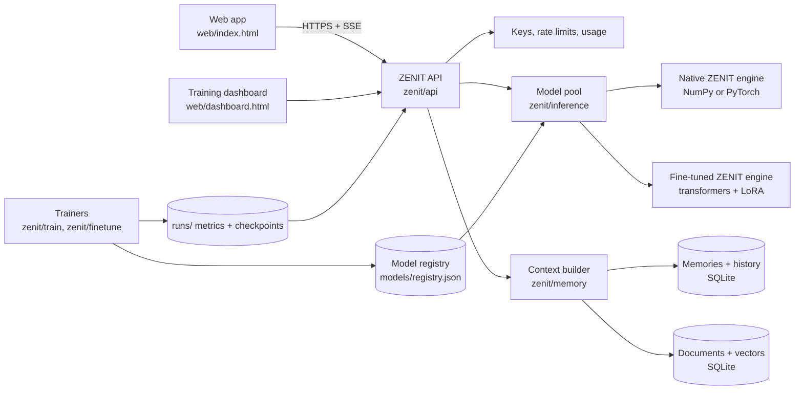

# ZENIT architecture

This document explains how ZENIT fits together and why each major choice was made.

## System overview



Every arrow stays on your machine. The model pool holds only local engines. No code path forwards a generation request to a third-party AI service.

## The ZENIT transformer

ZENIT is a decoder-only transformer. Code lives in two places with identical parameter names and tensor layouts:

* `zenit/model/numpy_model.py` is the reference. It has a hand-written backward pass, so it trains on any CPU with no PyTorch. A finite-difference test checks every gradient.
* `zenit/model/torch_model.py` is the fast version for GPUs. A parity test checks it produces the same logits from the same weights.

One block of the network:

```
x ──► RMSNorm ──► Attention (RoPE, GQA) ──► + ──► RMSNorm ──► SwiGLU MLP ──► + ──► next block
│                                           ▲    │                              ▲
└───────────────────────────────────────────┘    └──────────────────────────────┘
```

After the last block: RMSNorm, then a projection onto the vocabulary using the embedding matrix.

### Decisions and reasons

| Component | Choice | Reason |
|---|---|---|
| Layout | Decoder-only | Next-token prediction is the training goal for chat models. Encoders add nothing here. |
| Normalisation | Pre-norm RMSNorm | Normalising before each sublayer keeps gradients stable in deep stacks. RMSNorm skips mean-centring, so it costs less than LayerNorm and works as well in practice. |
| Position | Rotary embeddings (RoPE), theta 10,000 | Rotating queries and keys encodes relative distance directly in the attention score. No learned position table, and context length extends later with RoPE scaling. |
| Attention | Grouped-query attention (GQA) | Several query heads share one key/value head. This cuts the KV cache, the biggest memory cost at inference, by 2x to 4x with little quality loss. |
| Feed-forward | SwiGLU, hidden size about 8/3 of width | Gated activations train better than ReLU or GELU at the same parameter count. The 8/3 factor keeps the parameter count equal to a classic 4x MLP. |
| Output head | Tied with the input embedding | Saves vocab × width parameters, a large share of a small model, and tends to help small models generalise. |
| Biases | None | Biases add parameters and rarely help in this design. |
| Initialisation | Normal(0, 0.02), residual outputs scaled by 1/√(2·layers) | Keeps the residual stream variance steady as depth grows. |
| Tokeniser | Byte-level BPE with single-digit splitting | Byte fallback means no input fails to encode. Splitting digits one by one helps arithmetic. Chat roles get dedicated special tokens. |

The layout matches the Llama family on purpose. A native ZENIT checkpoint maps one to one onto Hugging Face `LlamaForCausalLM` weights, which opens the door to llama.cpp, GGUF and standard eval harnesses later.

### Model sizes

Parameter counts come from `ZenitConfig.num_parameters()`, not guesses.

| Preset | Width | Layers | Heads / KV heads | Vocab | Context | Parameters |
|---|---|---|---|---|---|---|
| nano | 128 | 4 | 4 / 2 | 1,024 | 128 | 857,216 |
| small | 512 | 8 | 8 / 4 | 16,384 | 1,024 | 31,597,056 |
| base | 768 | 12 | 12 / 4 | 32,768 | 2,048 | 100,682,496 |
| medium | 1,024 | 24 | 16 / 4 | 32,768 | 2,048 | 299,418,624 |

## Chat format

```
<|bos|><|system|>You are ZENIT ...<|end|>
<|memory|>Facts the user asked ZENIT to remember ...<|end|>
<|context|>[S1] report.pdf, page 3 ...<|end|>
<|user|>question<|end|>
<|assistant|>answer<|end|>
```

Memories and retrieved documents get their own roles. The model learns to treat them as supplied material, apart from what it learned in training. At inference, message text gets encoded with special-token parsing switched off, so a user typing `<|end|>` cannot forge a role change.

Fine-tuned models use their base model's chat template. Memory and document context then sit in clearly labelled `<memory>` and `<context>` sections of the system turn, and the trainer folds them the same way, so training and serving match.

## Training pipeline

```
manifest (licenses checked) ─► load ─► clean ─► quality filter ─► exact + MinHash dedup
   ─► train/val split ─► tokeniser training ─► tokenise ─► packed .bin + SFT .jsonl
   ─► resource estimate (refuses big jobs without --yes) ─► train loop ─► checkpoints
   ─► best-val export ─► model card ─► registry ─► evals
```

* Pretraining mode predicts every token. SFT mode supervises assistant tokens only.
* AdamW with decoupled weight decay on matrices only, linear warmup then cosine decay, gradient clipping at 1.0.
* Checkpoints every N steps, keep the last K, and keep the best validation checkpoint separately. Export uses the best one, not the last one, so overfitting does not leak into the released weights.
* `runs/<id>/run.json` and `metrics.jsonl` feed the dashboard. Creating a `STOP` file ends a run cleanly with a checkpoint.
* The PyTorch trainer adds bf16 autocast, gradient accumulation, gradient checkpointing, `torch.compile` and resume.

Fine-tuning (ZENIT 2.0 and later) uses LoRA adapters on every linear layer of an open-weight base. QLoRA (4-bit NF4 base weights) switches on when bf16 would not fit in VRAM. DPO then trains on preference pairs, with reference log-probabilities computed once up front so only one model copy sits in GPU memory. `merge.py` folds the adapter into full standalone weights.

## Inference

* `NativeEngine` runs native checkpoints with a KV cache. On the NumPy backend it uses the incremental `forward_cached` path. On PyTorch it uses a preallocated cache and fused attention.
* `HFEngine` runs fine-tuned ZENIT models through transformers with optional 4-bit loading and a cancellable streamer.
* Sampling: temperature, top-k, top-p, repetition penalty, stop strings, fixed seeds for reproducible output.
* Streaming decodes byte-level tokens incrementally and holds back partial UTF-8 characters, so streamed text never shows broken characters.

## Memory and retrieval

* SQLite holds users, API keys (hashed), conversations, messages, memories, documents, chunks and usage.
* Memories get saved only from explicit statements ("remember that...", "my name is...", "I prefer..."), or through the Memory panel. "Forget ..." deletes the closest match. Users list, edit, pin, export and delete everything, and memory switches off per user.
* Documents: text extraction (PDF, DOCX, HTML, text and code), paragraph-aware chunking with overlap, embeddings, cosine search.
* The default embedder hashes words, word pairs and character trigrams. It needs no download and gives good lexical search. Set `ZENIT_EMBEDDER=st:BAAI/bge-small-en-v1.5` for neural embeddings. Stored vectors record their embedder and reindex automatically on change.
* The context builder fills the model's window in priority order: system prompt, the new message, document passages (numbered [S1], [S2]), relevant memories, a summary of dropped turns, then as many recent turns as fit.

## API

Starlette with pydantic validation. FastAPI sits on Starlette, so moving to FastAPI later means wrapping these handlers, not rewriting them. Endpoints follow the OpenAI chat-completions shape, so existing client libraries work, with ZENIT extras for conversations, memory, documents and sources. See `docs/API.md`.

## Security

* Keys are `zk-` plus 32 random bytes. Only SHA-256 hashes get stored.
* Per-key token-bucket rate limits and optional daily token quotas.
* `--local` mode skips keys for loopback requests only, and refuses to start on a non-loopback host.
* Users see only their own conversations, memories and documents (tested).
* Uploads cap at 25 MB, unknown file types get refused, model output gets HTML-escaped before rendering.
* Model weights live in `models/`, apart from the web code in `web/`.
